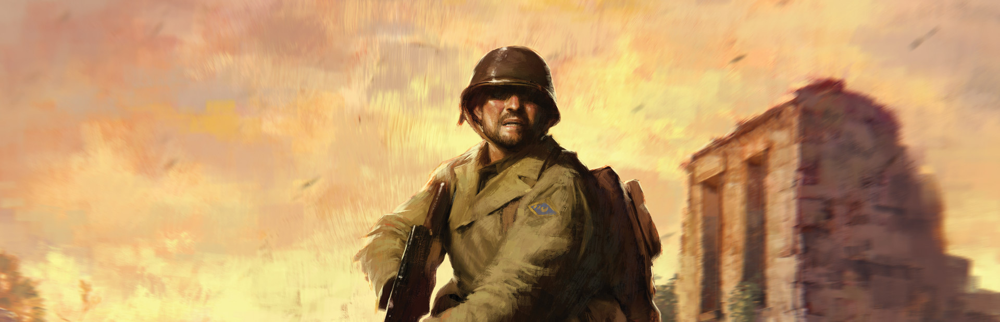

<p align="center">
  
</p>

# MOHAB Plus — by Harlock

Gameplay enhancement mod for **Medal of Honor: Above and Beyond** (Oculus/Meta version, Unreal Engine 4.25.3).

It is a **launcher** that injects [UE4SS](https://github.com/UE4SS-RE/RE-UE4SS) (v4.0.0) into the game and loads a Lua mod.
**It does not modify any game file**: if you start the game without the launcher, it works exactly as before.

## Disclaimer

MOHAB Plus is a personal, non-commercial fan project made by Harlock.

I have used artificial intelligence (AI) tools to make this mod: much of the research and code was done together with an
AI assistant.

My purpose is purely practical: to play Medal of Honor: Above and Beyond in a way that I personally find smoother and
more fun, and to share it with anyone who feels the same.

This mod has nothing to do with **Respawn Entertainment**, the studio that created the game, nor with Electronic Arts or
Meta. It is not affiliated with, endorsed or supported by them, so please do not contact them about problems with the
mod. Medal of Honor and the game's artwork and trademarks belong to their respective owners. The mod does not modify any
game file. Use it at your own risk.

## Features

Short, player-facing list: [FEATURES.md](FEATURES.md) (also shown in the launcher's **Features** tab). Details and defaults:

| Feature | What it does | Default |
|---|---|---|
| Trigger-activated syringes | A syringe is only injected if, besides bringing it to your chest, you pull the **trigger of the hand holding it** (configurable threshold). | On |
| Smaller syringes on the sleeve | Every syringe stored on the sleeve is drawn at 0.5 scale (configurable). They get their real size back when grabbed, before reaching your hand. | On |
| Grab distances | How close a hand must be to take something you carry. **Inventory** (grenades, mission objects on your chest, syringes on your sleeve) and **holstered weapons** have their own distance (5-30 cm; the game uses 30 cm on the sleeve). Within 3 cm the game always lets you grab. Weapons on the back / shoulders and the magazine pouch of the weapon in your hands keep the game's distance. | Inventory 10 cm, weapons 20 cm |
| Two-handed weapon grip reach | The free hand only grabs the second grip of a two-handed weapon when it is really close to it (the game stretches the grab area up to 2 m forward). | 10 cm |
| Pulling the pin with your teeth | How close a grenade in your hand must get to your mouth for its pin to come out with your teeth (0-15 cm, 0 = never; the game uses 10 cm), so it does not come out by accident when you take a grenade from your chest. | 5 cm |
| Flick to drop | With manual holsters off, a weapon you let go of still flies back to its holster, but letting go while flicking the hand (top speed relative to the body over the last 0.15 s at least 250 cm/s, adjustable 100-500) drops it, with the flick's speed. Either hand; pistols, long guns and grenades with the pin in. | On |
| No holster grabs over the head | While a hand is over your head (e.g. grabbing a helmet or hat), it does not grab the weapons holstered on your back. Hands at shoulder level still grab them. | 30 cm |
| Haptics on damage | Both controllers vibrate when you lose health. Intensity and duration grow with the damage. Optionally, the controller on the side of the hit vibrates harder. | On |
| Haptics on weapon handling | Vibration when inserting magazines, clips, shells or bullets, and when opening/closing break-action shotguns. | On |
| Haptics at holsters | A light tap when an empty hand gets within reach of a holstered weapon (not one held in the other hand) or something you carry (it asks the game what the hand would take, the same check the game makes when you press grip). | On |
| Crouch with the turn stick | Turn stick **down** = crouch; **up** = stand up (or jump, if you are already standing). How far the stick has to be pushed is adjustable (0.70 by default). You move crouched at 60% of your walking speed (adjustable, also when you crouch for real; the original game does not slow you down). Sprinting stands you up. | On |
| Jump (experimental) | Turn stick **up** while standing (how far it has to be pushed is adjustable, 0.70 by default, separately from crouching). Effort grunt and cloth sounds. You can climb onto tables, crates and rocks, but not over the level's invisible barriers, under a low ceiling, while swimming or while skiing. The levels were not designed for jumping, so a few spots may still let you reach places you should not. | On, 100 cm |
| Fall damage | The original game ignores how far you fall: from about 3.3 m up it always takes the same amount of health, from about 10 m you die. The mod lets you choose the height that starts hurting and the fatal height, makes the damage grow with the height (10% of the game's damage just above the safe height, 100% just below the fatal one) and scales it. Heights count from where the fall starts (the top of a jump). Off = the game's rules. | On, 3.5 m / 10 m, grows with height, x1.0 |
| Arm-swing sprint | `arms` mode: you run by moving the stick **and** swinging your arms like when running, without clicking the stick. It is **progressive**: the faster you swing, the faster you run (from walking speed up to maximum sprint). Stop swinging and you walk again immediately. `both` mode (**Stick + arms** in the menu): both ways work. `stick` mode: like the original game. | `both`, sensitivity 1.3 |
| Always sprint | `always` mode: you run just by pushing the stick and only walk while you aim a gun (hand from 35 cm below your eyes up, barrel within 35 deg of where you look, 45 deg with both hands on it; taking a rifle to a back holster or carrying it low does not count), while a hand holding a grenade or another explosive (dynamite, C4...) is raised (from 35 cm below your eyes up; lowered again from 42 cm down), or while you fire a gun (and for 0.6 s after the last shot). How far you push the stick sets the speed. Crouching works as usual. | Off |
| Progressive sprint | The stick-click and `always` sprints start at walking speed and reach the top speed over 1.5 s. Stopping, sliding, crouching or shooting starts over. | Always |
| Sprint speed | Multiplier of the game's maximum sprint speed, from x1.0 to x1.5. Also applies to stick-click sprint. Raising a weapon (same rule as **Always sprint**) or shooting cancels the stick-click sprint; click again to run. | x1.3 |
| Slide | Crouching while sprinting (with the turn stick or physically) makes you slide in the direction you were running. It starts a bit faster than your speed and slows down to crouch speed, so it is longer the faster you were running. You end up crouched. A scraping sound plays (`body`, `wood`, `metal` or `off`). | On, length x1.5, sound `body` |
| Skip cutscenes | **Hold both triggers and both grips for 1 s.** If the game marks the scene as skippable, the game's own skip is used. Otherwise, if you are locked in a scene, the sequences playing are skipped to their end. In dialogue scenes (NPC skits) the action is fast-forwarded (x12 by default) until the dialogue ends. Vibrates when skipping. | On |

## Requirements

* Windows 10/11 x64 and the game installed from the Oculus/Meta store.
* [.NET 8 Desktop Runtime x64](https://dotnet.microsoft.com/download/dotnet/8.0) (for the launcher).
* Works with Virtual Desktop and with Meta Quest Link / Air Link.

## Installation and usage

1. Download `MOHABPlus-vX.Y.Z.zip` from the [Releases page](https://github.com/HarlockBcn/MOHAB-VR-Mod/releases) and extract
   the `MOHABPlus` folder anywhere. It does not need to be inside the game folder.
2. Open `MOHABPlusLauncher.exe`. It finds the game folder by itself; if not, use **Browse...**.
3. There are two ways to play:
   * **From Virtual Desktop or Meta Quest Link / Air Link (recommended)**: keep the launcher open (or minimised: it goes to the system
     tray) with *"Load the mod automatically..."* ticked. Start the game as usual from Virtual Desktop or the Meta app. About 5 s after the game window
     appears, the mod loads by itself.
   * **"Launch game with MOHAB Plus" button**: starts the game directly (the same way VD does) and loads the mod.
4. The **Mod settings** tab of the launcher has the same options as the in-game menu.

The installed version is always shown in the launcher (top-right corner, title bar and footer).

Command lines (no window; they write to `launcher.log`):

```powershell
.\MOHABPlusLauncher.exe --launch
```
```powershell
.\MOHABPlusLauncher.exe --watch
```

## Updates

When the launcher starts (and whenever you click the update status next to the tabs) it checks this GitHub repository
for a newer release. If there is one, a bar shows the new version number with:

* **What's new**: the release notes.
* **Update to vX.Y.Z**: downloads the release zip, replaces the mod files and restarts the launcher. Your settings
  (`launcher.ini` and `ue4ss\Mods\MOHABPlus\config.ini`) are kept. Close the game first.

Without an internet connection the launcher works as usual. You can also update offline with a downloaded zip:

```powershell
.\MOHABPlusLauncher.exe --install-zip C:\Downloads\MOHABPlus-v1.2.0.zip
```

## In-game menu

* **Hold the Y button (left controller) for 1.5 s** to open or close it. In the original game that button does nothing.
* A text panel floats in front of you. While it is open you do not move or shoot.
* Left column: the **MOD ON/OFF** switch and the categories. Right column: the options of the chosen category, with a
  short explanation of the selected one at the bottom.
* **Stick up/down**: choose. **A**, **trigger** or **stick right**: open the category. **B**: close.
* Inside a category, the stick only moves (**left** or **B** goes back). **A** or **trigger** switches an ON/OFF option, or
  starts **editing** any other one (shown in orange).
* While editing: **stick left/right** changes the value, **A** or **trigger** confirms it, **B** cancels and brings the
  previous value back. Closing the menu also cancels. Nothing else works until you confirm or cancel.
* **Grips**: previous / next category.
* **MOD ON/OFF** (or **holding a thumbstick click** for half a second in the menu) turns every change of the mod off and on again, to
  compare with the original game. Your settings are kept, and the mod is always on when the game starts.
* Changes are saved to `ue4ss\Mods\MOHABPlus\config.ini` when the menu closes.

## How it works (technical summary)

* **Syringes**: `BP_HealthSyringe` is injected when its `Box` component starts overlapping the player's chest
  (`Mesh_Chest`). The Blueprint enables the `Box` overlap events 0.05 s after grabbing it (`SyringeOverlapOn`).
  The mod turns them off again right away and only enables them while you pull the trigger of that hand.
  Pulling the trigger forces an overlap check (otherwise the game waited for the box to move), and the box stays active
  0.4 s after releasing it. Also, since the Blueprint only injects if the *last* overlap event was with `Mesh_Chest` (and
  when the box is enabled while touching several body parts the order is random), while you pull the trigger the mod
  checks `Box.IsOverlappingComponent(Mesh_Chest)` itself and calls the game's injection (`SyringeUsed`).
  The game hides spare syringes with scale 0, so the mod only undoes the scale it applied itself.
  A syringe is "on the sleeve" if it is attached (directly or indirectly) to the cuffs, the hands or the player.
  They are scaled with `SetActorScale3D`. When grabbed, the game (`BP_MotionController:AttachObjectToHand`) reads its scale
  and then attaches the hand to it: that is why the scale goes back to 1 in a pre-hook of `Actor:GetActorRelativeScale3D`,
  before that attachment. A held syringe is never rescaled (otherwise the hand would change size).
* **Weapon grip reach**: `BP_MotionController:UpdateGrabCapsule` stretches the hand's grab capsule forward every frame.
  While the other hand holds a weapon, the mod pre-hooks the capsule's `K2_SetRelativeLocation`/`SetCapsuleHalfHeight` near
  that weapon and disables the overlap events of the grip colliders while the free hand is farther than the configured
  reach. If a second grip comes loose from its weapon, the mod reattaches it.
* **Body grab distance**: `BP_VRPlayerCharacter:GetNearestHolsterSlot` measures the hand's distance to 8 points
  (indices 0-5 = holster slots 3, 0, 5, 2, 4, 1; 6-7 = sleeves) and takes the nearest one if its squared distance is
  within `SlotToDistanceSquaredLeewayMap[index]` (900 = 30 cm) or under 3 cm. The mod writes the weapon distance² into
  slots holding a weapon (weapons owned by the player's `HolstersComponent` and not gripped, grenades excluded) or where a held weapon goes back
  (`AppropriateHolsterSlot`), the inventory distance² into the rest, and leaves `PrimaryBackHolsterSlot` /
  `SecondaryBackHolsterSlot` and the held weapon's `MagazineHolsterSlot` with the game's value.
  Note: the game only checks the **nearest** point that holds something; if it is out of its distance nothing is
  taken, even when a farther item is within its own. Grip presses that take nothing near the body are logged
  (`grab missed`).
* **Manual holsters** (`manualholster.lua`): a released weapon (`IsGripped` and `HoldingWeaponWithOffhand` both false since the
  last tick) is already flying back (`HolsterLerp` timelines). The mod stops the timelines and either ends them at once
  (`SetWeaponToHolsterSlot` if the slot changes, then `MoveWeaponToHolster__FinishedFunc`) or drops the weapon
  (`ThrowHolsteredWeaponInFrontOfOwner` without relocation; it zeroes `Ammo`, which is restored). `HolstersComponent.Actors` holds
  proxies (`BP_WeaponBaseProxy.WeaponRef`). Floor weapons with no free holster get the free chest slot (1) so picking
  them up swaps nothing (the two-handed grip needs a registered slot).
* **Row of grenades** (`grenaderow.lua`): the game keeps grenades as ammo counts (`GetAmmoByIndex` 2, 3, 7; 3 in total, the ones in
  the hands included) plus one real actor in `GrenadeHolsterSlot`. The mod draws one `StaticMeshActor` per grenade (mesh copied
  from the slot's proxy, which is hidden) and keeps the real one of the type nearest to the hand, or takes it with
  `AttachObjectToHand` after the game's grip press (post-hooks on `...ControllerGrabPressed`).
* **Holsters over the head**: `GetNearestHolsterSlot` uses `SlotToDistanceSquaredLeewayMap` (indices 0-5 = holsters,
  6-7 = sleeves). While a hand is over the head and near its axis, the mod zeroes the holster leeways.
* **Haptics**: the mod watches the health of `VRPlayerCharacterHealthAndDamageComponent` and uses
  `PlayerController:SetHapticsByValue`. The hit direction comes from `HandleDamageLocationIndicator`. Weapon haptics hook
  the weapons' load functions (`LoadMag`, `LoadAnotherShell`, `LoadAmmo`) and the sawed-off's barrel open/close animations.
* **Crouch**: in standing mode (`IsStandingMode`, the normal one) the game has no button crouch: it infers that you are
  crouched from your real head height (≤ 120 cm). The mod lowers the `VROrigin` by about 60 cm with a smooth transition
  (more if you are tall, to get below 120 cm; never closer than 70 cm to the floor). So the game itself treats you as
  crouched: capsule, AI visibility and speed. In seated mode it uses the game's crouch (`UserToggleVRCrouch`).
* **Sprint**: `BP_R6PlayerController.TickInput` sets `CharacterMovement.MaxWalkSpeed` every frame. The mod runs right
  after it (post-hook). With the gesture it sets `IsSprinting` and a speed between walking (`MoveSpeedData.MaxWalkSpeed`)
  and `MaxSprintSpeed × multiplier`, depending on how fast you swing. When the gesture stops, on death or on pawn change
  it clears the sprint state.
  The gesture is detected from the velocity of each hand relative to the head (forward/up components): hands moving in
  opposite directions, with a smoothed average and hysteresis.
* **Slide**: when crouching with `IsSprinting` active and real speed > 1.15 × walking, it sets the initial speed
  (current speed × 1.25) and every frame, after `TickInput`, lowers `MaxWalkSpeed` at 650 cm/s² (÷ length) and adds
  movement in that direction. It ends on reaching crouch speed, on a collision or when falling. The sound is a Wwise
  event: the mod loads its bank (`RequiredBank`) with `AkGameplayStatics.LoadBanks` and plays it with `PostEventAttached`;
  looping sounds are stopped with their `Stop_` event. Afterwards, the arm swing has to stop once before you can stand up
  again.
* **Fall damage**: the player's `Comp_FallDamage` only looks at the vertical speed of the last frame before landing
  (`LastVelocity.Z`): from `NonFatalFallVelocity` (800 cm/s) it applies a flat `NonFatalDamage`, from `FatalFallVelocity`
  (1400 cm/s) a fatal hit. The mod writes both thresholds from the chosen heights (v = √(2·g·h)) and sets
  `NonFatalDamage` from `LastVelocity` every frame and in a post-hook of `StopFalling`, which runs right before
  `ApplyFallDamage`. The original values are put back when the option or the mod is off.
* **Skip cutscenes**: the game already has a skip for some scenes (`BP_R6GameModeBase.bInSkippableScene`,
  `TimerExpired_SceneSkip` → `CutsceneSkipped` in the level). Outside those, and only while the player is locked
  (`bFootlocked`/`bGamelocked`), it calls `GoToEndAndStop` on the `LevelSequencePlayer`s that are playing and not looping.
  Dialogue skits advance on timers, so they are fast-forwarded with `SetGlobalTimeDilation` while they play.

## Troubleshooting

* **Settings**: the launcher's *Mod settings* tab reloads by itself when you change something in the in-game menu.
* **Log**: `ue4ss\UE4SS.log` (*Open UE4SS log* button). The mod's lines start with `[MOHABPlus]`. When a level loads you
  should see `player found` and several `hooked ...` lines.
* **More detail**: enable *Verbose logging* (or `debug_log=true` in `config.ini`). With that option on when the game
  starts, a test channel is also enabled: write a command in `ue4ss\Mods\MOHABPlus\cmd.txt`
  (`status`, `menu`, `crouch`, `stand`, `haptic`, `damage`, `set <key> <value>`...; full list in `Scripts\devtools.lua`).
* **The game closes when the mod loads**: the launcher waits for the game window to exist before injecting. Injecting
  at process start makes the game close.
* **The update fails**: close the game and try again, or download the zip from the Releases page and use `--install-zip`
  (or extract it over your current folder).

## Project structure (development)

```
launcher/                 Launcher/injector/updater (.NET 8 WinForms)
  Resources/              Banner, logo and icon (game artwork)
mod/ue4ss/                Content shipped next to UE4SS.dll (settings, mods.txt, Lua mods)
  Mods/MOHABPlus/Scripts  main, config, util, syringe, weapongrip, holster, haptics, crouch, sprint, slide, jump, jumpguard, falldamage, bodygrab, cutscene, menu, devtools
  Mods/MOHABDump          Class dump (only with build -Dev)
third_party/UE4SS         Official UE4SS v4.0.0 release (unmodified)
tools/                    release.ps1, get-ue4ss.ps1, pak_list.py, pak_extract.py, uasset_info.py, kismet_dis.py (Blueprint disassembler)
research/                 Game class/header dump generated with UE4SS
VERSION                   Mod version (MAJOR.MINOR.PATCH), the single source used by the launcher
CHANGELOG.md              Release history
FEATURES.md               Player-facing feature/fix list, embedded in the launcher's Features tab
build.ps1                 Builds dist\MOHABPlus
```

Build (the first time, download UE4SS into `third_party\UE4SS`; it is not in the repository):

```powershell
powershell -ExecutionPolicy Bypass -File .\tools\get-ue4ss.ps1
```
```powershell
powershell -ExecutionPolicy Bypass -File .\build.ps1
```

### Releases

Versions follow `MAJOR.MINOR.PATCH` and are tagged `vMAJOR.MINOR.PATCH`. To prepare one (clean working tree, launcher
and game closed):

```powershell
powershell -ExecutionPolicy Bypass -File .\tools\release.ps1 -Version 1.2.0 -Draft
```
```powershell
powershell -ExecutionPolicy Bypass -File .\tools\release.ps1 -Version 1.2.0 -Notes .\dist\release\CHANGELOG-DRAFT-v1.2.0.md
```

The first command writes a changelog draft from the commits since the last tag; edit it and pass it with `-Notes`. It
warns if there are `feat`/`fix` commits but `FEATURES.md` was not updated. The
second one bumps `VERSION`, adds the section to `CHANGELOG.md`, builds, writes `dist\release\MOHABPlus-v1.2.0.zip` and
`dist\release\RELEASE-NOTES-v1.2.0.md`, commits and creates the tag. Then push (`git push origin main --follow-tags`) and
create the GitHub release for the tag with the zip as its binary and the notes as its description. The launcher's update
check uses the latest published (non-prerelease) GitHub release.

## Licenses

UE4SS is distributed under its own license (`ue4ss\UE4SS-LICENSE.txt`). Medal of Honor: Above and Beyond belongs to
Electronic Arts / Respawn. The launcher's banner, logo and icon use official artwork of the game, © Electronic Arts;
this is a non-commercial fan project, not affiliated with or endorsed by them. The mod does not include any other game
content.
